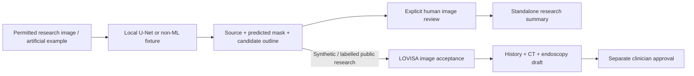

# LOVISA Endoscopy — Image-first polyp research assistant

A locally deployed application that proposes candidate polyp regions in a single
colonoscopy image, shows source-linked annotations and pixel-area measurements,
and requires human review. It connects to
[LOVISA](https://github.com/LilyC2024/Medical-AI) alongside the lung-nodule CT
companion. It does not diagnose cancer or establish a normal examination.



## What works

- Dataset validation, related-image grouping and immutable train/validation/test manifests.
- Compact U-Net CPU training, held-out evaluation, ONNX export and actual CPU parity checks.
- ONNX Runtime CPU inference; optional OpenVINO CPU/NPU with explicit device selection and numerical checks.
- A local Streamlit image viewer with candidate decisions and separate research-review export.
- Separate bounded synthetic/public-research exchanges into LOVISA: candidate inspection, authenticated acceptance and combined reports with pictures.

The 24-epoch **exploratory Kvasir-SEG repeat** achieved mean Dice **0.544**
(IoU 0.413) on the frozen 168-positive-image test split; the earlier 12-epoch
baseline was 0.446. The checkpoint was selected by validation loss, but this
test split had already been examined, so the repeat is not independent validation. It has no real negative-examination evaluation and
patient independence is not established. These results are insufficient for
clinical deployment. Artificial-image tests measure software behavior only.
[Actual results and limitations](EVALUATION.md).

## Real-image LOVISA demonstration

The Jordan research-composite case can include a real CT excerpt and unrelated
Kvasir endoscopy image. Public endoscopy evidence uses `lovisa-endo-research-v2`,
with dataset/license/image provenance and `synthetic: false`; artificial-v1 stays
supported. Images remain separate from fictional medical history. No image
result diagnoses cancer or enters the LLM. [Export and UI workflow](docs/LOVISA.md).

LOVISA has shorter result summaries, optional notes, green selected confirmations
and yellow/green decision choices. Each inclusion or final approval still needs
explicit submission. Three actual research JPGs and their prepared predictions
can be generated locally with the [LOVISA research-kit script](https://github.com/LilyC2024/Medical-AI/blob/main/docs/RESEARCH_IMAGES.md).

## Run locally

Use Python 3.12 for the validated ML environment. Reuse an existing `.venv`.
For a fresh checkout:

```bash
python3.12 -m venv .venv
.venv/bin/python -m pip install torch==2.14.1+cpu --index-url https://download.pytorch.org/whl/cpu
.venv/bin/python -m pip install -e '.[ml,ui,dev]'
.venv/bin/python -m endo.cli demo --output artifacts/first-example
.venv/bin/python -m streamlit run app.py --server.address=127.0.0.1 --server.port=8503
```

The non-ML artificial example needs no weights. Installed-model mode requires
explicit training and registration; inference never downloads weights or calls a
cloud service. Windows commands and optional NPU setup are in [Setup](docs/SETUP.md).

## Documentation

| Guide | Purpose |
| --- | --- |
| [Quick workflow](docs/WORKFLOWS.md) | Run, inspect, review and export an image study |
| [Training and evaluation](docs/TRAINING.md) | Data acquisition, frozen splits, training, export and benchmark commands |
| [LOVISA integration](docs/LOVISA.md) | Separate environments, synthetic/public evidence, composite binding and reports |
| [Architecture and agents](docs/ARCHITECTURE.md) | Data structures, model versus Agent versus LLM responsibilities |
| [Code reference](docs/CODE_REFERENCE.md) | Folder/module/function responsibilities |
| [Data card](docs/data_card.md) | Source terms, dataset validation and known gaps |
| [Evaluation](EVALUATION.md) | Executed tests, real inference, timings and untested hardware |
| [Implementation plan](PLAN.md) | Tested phase gates |

Models, datasets, credentials and generated workspaces stay out of Git. Research
data are not synthetic patient records. Code publication grants no dataset or
third-party model rights. Kvasir-SEG use is research/education only unless its
publisher grants commercial permission. This repository has no selected
project-wide redistribution license. [Security and scope](SECURITY.md).
