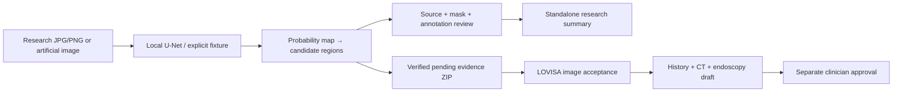

# LOVISA Endoscopy

**Local image-first polyp candidate research assistant.** A single permitted
colonoscopy image becomes a source-linked candidate overlay and a short,
human-reviewed research summary. This companion supplies image evidence to
[LOVISA](https://github.com/LilyC2024/Medical-AI), alongside the
[lung CT assistant](https://github.com/LilyC2024/ai-medimg-2.5D-CT).

## How it works



ONNX Runtime runs the model on CPU; optional OpenVINO devices are selected
explicitly and checked numerically. Region areas are **pixels**, not millimetres.
The companion has no LLM. LOVISA's language model reasons over fictional history;
accepted image observations are added in Python, without sending images to it.

## Start locally

Use Python 3.12 for the tested ML setup. Reuse an existing `.venv`; for a new clone:

```bash
git clone https://github.com/LilyC2024/AI-MedImg-Endo.git
cd AI-MedImg-Endo
python3.12 -m venv .venv
.venv/bin/python -m pip install torch==2.14.1+cpu --index-url https://download.pytorch.org/whl/cpu
.venv/bin/python -m pip install -e '.[ml,ui,dev]'
.venv/bin/python -m endo.cli demo --output artifacts/first-example
.venv/bin/python -m streamlit run app.py --server.address=127.0.0.1 --server.port=8503
```

The artificial fixture needs no weights. Real-image inference requires an
explicitly trained/exported local model. Setup may download packages; inference
never downloads models or calls a cloud service.
[Windows, environment and acceleration setup](docs/SETUP.md).

## Use with LOVISA

Open **Endoscopy review → Upload → Analyze** in LOVISA. A review ZIP opens its
included results; an approved research-kit JPG/PNG runs the installed polyp model.
Inspect every candidate and explicitly include or exclude it before image
acceptance. Safety assessment and final clinical approval remain separate.
Public images belong only to labelled fictional composite cases, with dataset,
permission and subject provenance. [Exact integration workflow](docs/LOVISA.md).

## Understand the implementation

| Guide | Contents |
| --- | --- |
| [Documentation index](docs/README.md) | Operation, architecture, data and development routes |
| [Image workflow](docs/WORKFLOWS.md) | Input, annotations, review, errors and outputs |
| [Training](docs/TRAINING.md) / [Data card](docs/data_card.md) | Frozen groups, preprocessing, evaluation and reproducibility |
| [Architecture](docs/ARCHITECTURE.md) / [Code reference](docs/CODE_REFERENCE.md) | Schemas, folders, functions and runtime responsibilities |
| [Validation](docs/VALIDATION.md) / [Evaluation](EVALUATION.md) | Reproduce tests; separate actual inference from scripted checks |
| [Expert review](docs/REVIEW.md) | Reproduced bugs, repairs and remaining risks |

**Research and education only.** This exploratory segmentation model does not
establish cancer, histology, anatomical location or a normal examination. The
Kvasir evaluation has no negative examinations and does not establish patient
independence. No clinical or NPU deployment claim follows from passing tests.

Keep images, weights, workspaces and credentials outside Git. Dataset permission
is separate from code publication; no project-wide redistribution license has
been selected. [Security](SECURITY.md) · [Contributing](CONTRIBUTING.md).
