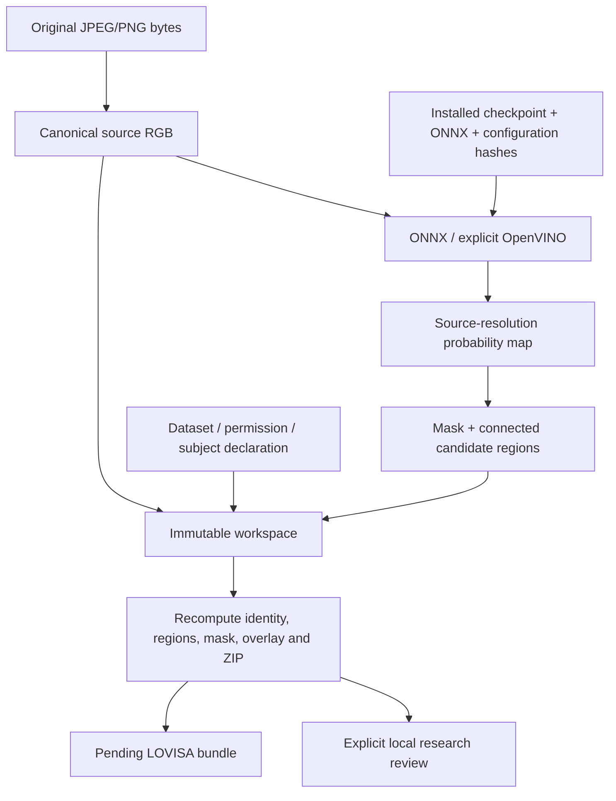

# Endoscopy architecture and evidence flow

[Overview](../README.md) · [Code reference](CODE_REFERENCE.md) · [LOVISA integration](LOVISA.md)

## Processing stages

1. Decode one bounded JPG/PNG, retain original bytes, and create canonical RGB.
2. Verify an installed model registration. Resize/normalize for U-Net, run the
   explicitly selected local backend and restore probabilities to source size.
3. Threshold the probability map and find 4-connected regions. Derive boxes,
   pixel areas and scores from predictions, never from reference masks.
4. Write a new workspace containing source, predictions and identity hashes.
5. Reverify evidence before accepting a local research review or downloading.
6. Export pending synthetic/public evidence for LOVISA's separate acceptance.

## Data structures and coordinates

| Structure | Meaning and invariant |
| --- | --- |
| `ModelInfo` | Checkpoint/recipe identity, backend, threshold, minimum region area and evaluation scope |
| `Study` | Source RGB digest, source dimensions, input kind, aliases, unknown acquisition date and candidates |
| `Candidate` | Half-open source-pixel `x0,y0,x1,y1` box, predicted mask area and mean model score |
| `Review` | Exact study digest, reviewer attestation and one resolved decision per candidate |
| `PublicResearchSource` | Dataset, HTTPS source, terms, original-byte hash, subject declaration and composite-case flag |
| `Bundle` | Synthetic-v1 or public-research-v2 plus exact declared source/probability/mask/overlay artifacts |

Area fraction is predicted mask area divided by image area. It is not physical
lesion size. Disconnected regions are not adjudicated distinct polyp identities.
CT's HU, spacing, three-dimensional boxes and calipers are not reused here.

## Modules and trust boundaries

`endo.data` checks inventories/frozen groups; `train` uses validation-only model
selection; `deploy` exports/registers numerical parity; `inference` verifies and
runs the selected backend; `workspace` preserves and verifies evidence;
`exchange` builds pending bundles; `cli` and `app.py` expose the operations.
`endo_contracts` is ML-free and copied exactly into LOVISA.

New workspaces bind `research.json` and the exported ZIP in provenance. Verification
also compares their typed study, source and predictions with the workspace, so a
self-consistent unrelated ZIP is insufficient. Older workspaces without the new
hash fields remain readable only after the same direct evidence checks.
Changing model/backend/research permission cancels stale UI work and clears its
old review controls. Workers cannot publish late results after cancellation.

## Agents, LLMs and review

The segmentation network is a CV model. LOVISA's `LocalEndoscopyJob` is a bounded
subprocess adapter, sometimes described as the Endoscopy Agent; it is not an
LLM persona or an autonomous tool user. LOVISA's four specialist roles remain
history, medication, reasoning and deterministic safety. Only reasoning calls
local Ollama. Images and image notes never enter that LLM or expand its catalog.

Standalone review authenticates no professional identity. LOVISA supplies its own
local-account receipt and final content binding. Neither hash consistency nor a
review attestation proves permission, producer authenticity or clinical truth.
[Security assumptions](../SECURITY.md).
